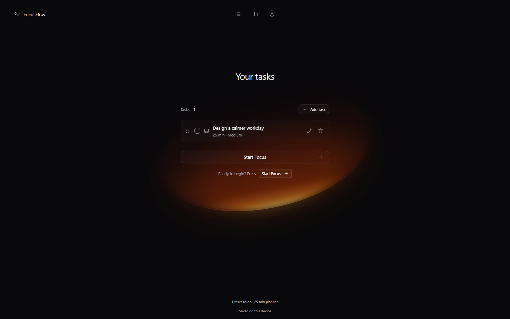
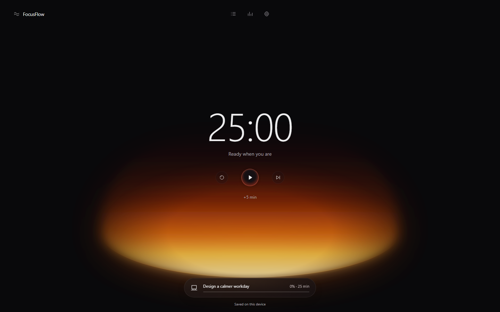
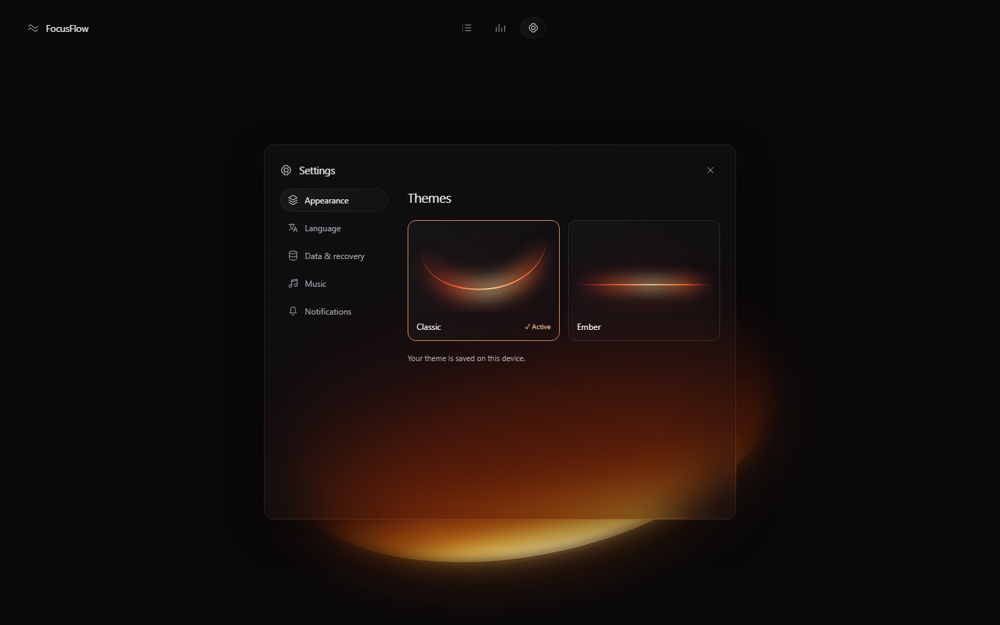

# FocusFlow

### A little more focus. One task at a time.

A calm, browser-based workspace for planning your day, focusing on one task, and
understanding where your time goes. Built with Vue 3 and TypeScript, with
glass surfaces and animated lighting that follows your workflow.

**[Try the live demo →](https://focusflow-three-silk.vercel.app/)** ·
[Watch onboarding](docs/media/onboarding.webm) · [Release changes](CHANGELOG.md)

[](https://github.com/mar4enkoP/focusflow/actions/workflows/ci.yml)



## From a thought to focused work

Start with a task title. Add an estimate, category, and priority, then open the
focus timer when you are ready. Your workspace stays in your browser, with no
account or backend required.

| Focus on one thing                   | Make the space yours                       |
| ------------------------------------ | ------------------------------------------ |
|  |  |

Screenshots and the [short onboarding recording](docs/media/onboarding.webm) show
the local v1.1.0 candidate with sample data. The hosted demo may follow a different
commit. [Capture details](docs/media/README.md).

## What you can do

- **Organize tasks** — create, edit, complete, reorder with drag or keyboard, and
  undo the latest deletion within ten seconds.
- **Work with a timer** — start, pause, resume, reset, add time, and explicitly
  complete tasks. Overtime can continue recording after the countdown reaches zero.
- **Reuse familiar work** — inline title completion with Tab, remembered task
  details, and editable duration suggestions from reliable completed sessions.
- **Plan a session** — select tasks, set a time budget and breaks, review a proposal,
  accept it, and recalculate the remaining schedule.
- **Review your activity** — recorded focus time, daily activity, categories,
  completions, and planned-versus-actual accuracy.
- **Personalize your space** — Classic and Ember lighting, English and Russian.
  Theme selection unlocks after the first task is created.
- **Manage local data** — export recovery JSON, validate and import a backup, or
  reset the workspace with confirmation. Imported running timers resume paused.

Music and notifications currently have **In development** panels. Background
music, notification sounds, and German localization are upcoming work.

## Built with

**Vue 3 · TypeScript · Pinia · Vite · SCSS**

Vitest and Vue Test Utils cover domain and component behavior. Playwright covers
Chromium workflows. ESLint, Oxlint, Prettier, and TypeScript run in GitHub Actions.

## Run locally

Use Node.js `^22.18.0 || >=24.12.0` and npm. CI uses Node.js 24.

```sh
npm ci
npm run dev
```

Open the URL printed by Vite. Workspace editing requires Web Locks support and
HTTPS or localhost.

```sh
npm run build
npm run preview
```

The build type-checks the application and writes static assets to `dist/`.

### Verify

```sh
npm run test:unit -- --run
npx eslint .
npx oxlint .
npx prettier --check .
npm run build
npx playwright install chromium
npm run test:e2e
```

On Linux, use `npx playwright install --with-deps chromium`. The E2E suite starts
a production preview on port 4173. [Browser test guide](src/e2e/README.md).

## Architecture and reliability

| Area                                               | Responsibility                                                |
| -------------------------------------------------- | ------------------------------------------------------------- |
| `src/components/`                                  | Task flows, timer, settings, planner, analytics, and lighting |
| `src/stores/`                                      | Shared task, timer, history, planner, and ownership state     |
| `src/planning.ts`, `estimation.ts`, `analytics.ts` | Scheduling and derived metrics                                |
| `src/workspace.ts`, `workspaceOwnership.ts`        | Exclusive Web Lock and page lifecycle                         |
| `src/persistence.ts`, `workspaceTransfer.ts`       | Validated storage, backup import, and reset                   |
| `src/visuals/`, `src/assets/`, `src/i18n.ts`       | Motion helpers, styles, and translations                      |

One cooperating tab owns workspace writes. Waiting tabs are read-only and hydrate
the latest saved data before becoming editable. Storage validation protects
recognized damaged data from overwrite. Detectable backward clock changes pause
affected countdowns, and unreliable history is excluded from duration learning.

The interface includes keyboard controls, focus restoration, and reduced-motion
handling. These affordances have automated coverage, with no claim of a formal
accessibility audit. [Reliability details](RELIABILITY.md).

## Scope and limitations

- Data is local to this browser profile and origin. There is no cloud sync.
  Clearing site data removes it, so export a backup before moving devices.
- Storage keys are separate writes, without database transactions. Storage denial,
  quota limits, and damaged backups can prevent saving or import.
- The planner uses wall-clock time. Moving the clock backward can increase its
  remaining budget. Review and recalculate after correcting system time.
- Exact elapsed work cannot always be reconstructed across clock changes.
- Automated browser coverage targets Chromium. Cross-browser, accessibility, and
  broader visual reviews remain release work.
- Close or reload older tabs when upgrading so every tab uses the ownership protocol.

Next priorities include background music, notification sounds, German localization,
and broader browser/accessibility testing. [Development roadmap](ROADMAP.md).

## License and reuse

This repository is available for public viewing and portfolio review. No general
license to use, modify, redistribute, or commercially reuse the project is granted.
Separate permission from the copyright holder is required, subject to applicable
law and GitHub's platform terms. Third-party dependencies retain their own licenses.

The intended copyright holder is Pavlo Marchenko, with the spelling pending
confirmation against identity documents.

See the [publication review](docs/release/FINAL-REVIEW.md) for asset provenance,
dependency findings, and remaining release decisions.
